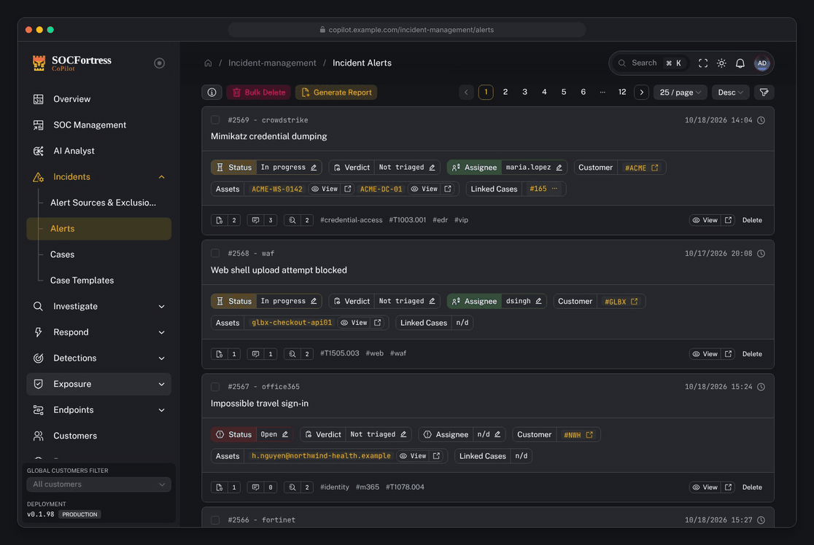
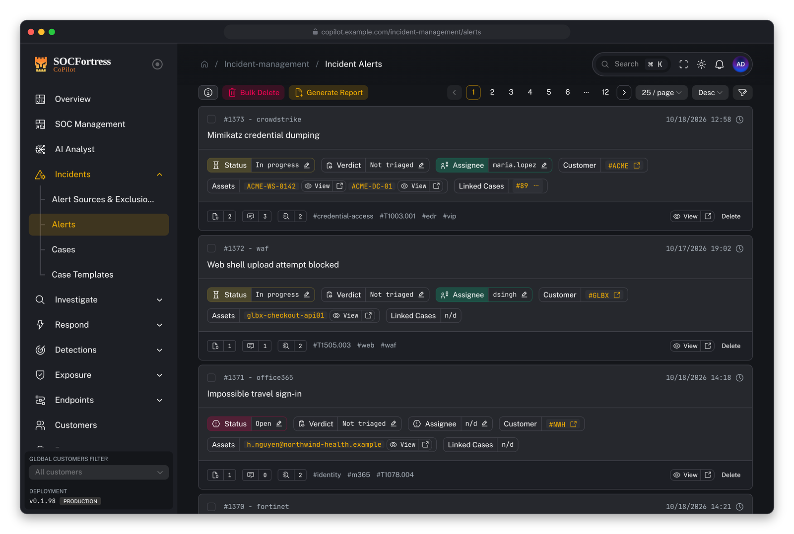
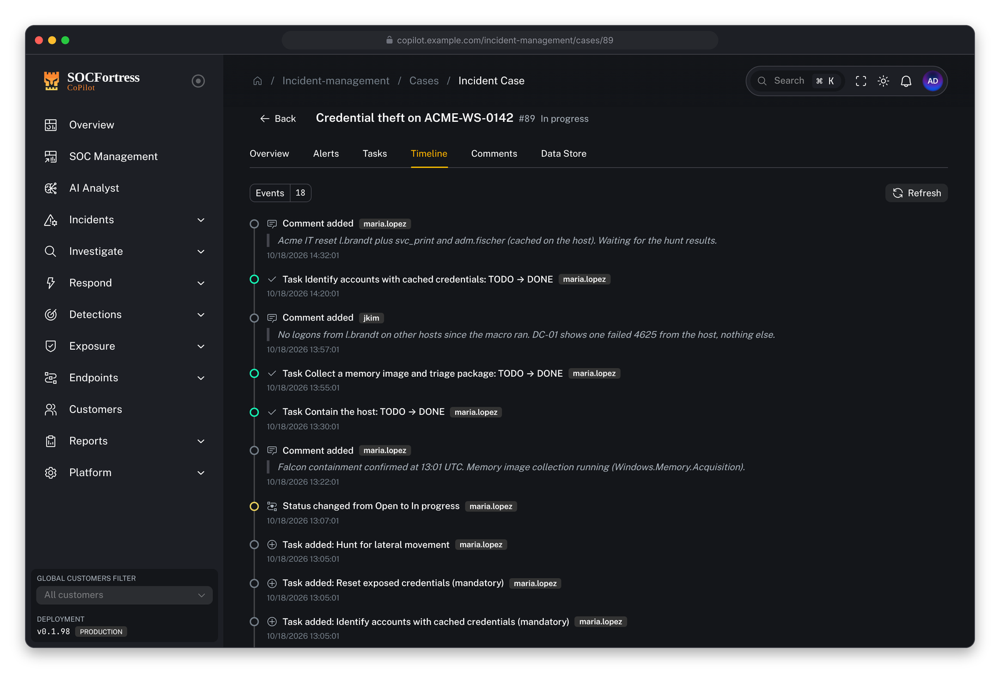
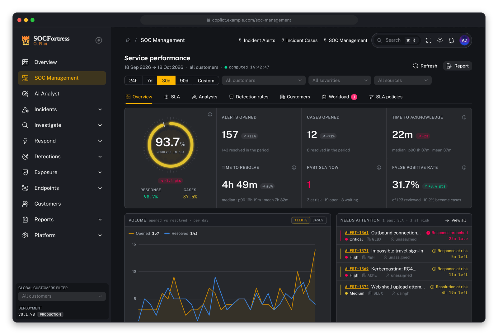
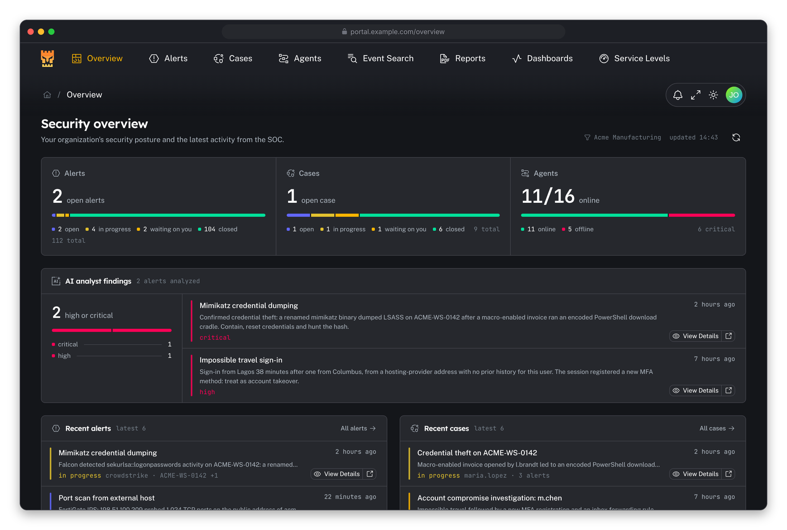

<div align="center">

<a href="https://www.socfortress.co">
  <picture>
    <source media="(prefers-color-scheme: dark)" srcset="docs/assets/readme/hero-dark.svg">
    <source media="(prefers-color-scheme: light)" srcset="docs/assets/readme/hero-light.svg">
    
  </picture>
</a>

### Run your whole SOC from one screen.

CoPilot connects **Wazuh, Graylog, Velociraptor** and 30+ other tools, turns their alerts into cases,<br>
tracks your SLAs and gives every customer a portal of their own. Open source, self-hosted.

[](https://docs.socfortress.co)
[](LICENSE)
[](https://discord.gg/UN3pNBzaEQ)
[](https://www.youtube.com/@taylorwalton_socfortress?sub_confirmation=1)
[](crates/)
[](frontend/)

[**Quick start**](#-quick-start) · [**Tour**](#-take-the-tour) · [**Features**](#-what-you-can-do) · [**How it works**](#-how-it-works) · [**Integrations**](#-integrations) · [**Docs**](https://docs.socfortress.co)

</div>

<br>

## 🎬 Take the tour

<p align="center">
  
</p>

<p align="center"><sub>Alert queue → one alert → its case → SLA dashboard → customer portal. All screens are real, the data is a demo.</sub></p>

<br>

## ✨ What you can do

<table>
<tr>
<td width="50%" valign="top">

### 🚨 Triage every alert in one queue

Alerts from every connected tool land in **one list, in one format**. Assign them, comment, set a status and a verdict, and see the assets and IoCs at a glance.

- Merges repeats of the same alert automatically
- Tag-based access and per-customer scoping
- An AI analyst can investigate an alert for you

</td>
<td width="50%" valign="top">

<picture>
  <source media="(prefers-color-scheme: light)" srcset="docs/assets/readme/screens/alerts-light.png">
  
</picture>

</td>
</tr>
<tr>
<td width="50%" valign="top">

<picture>
  <source media="(prefers-color-scheme: light)" srcset="docs/assets/readme/screens/case-detail-light.png">
  
</picture>

</td>
<td width="50%" valign="top">

### 🗂️ Turn alerts into cases

Group related alerts into a **case**, work through its tasks and keep the whole story in one timeline.

- Case templates add the right tasks for each alert type
- Files, comments and a full audit trail per case
- One-click PDF and Word reports

</td>
</tr>
<tr>
<td width="50%" valign="top">

### 📈 Know that you meet your SLAs

**SOC Management** shows how fast your team acknowledges and resolves, per customer, severity and analyst.

- Response and resolution targets, with business hours
- "Waiting on customer" pauses the clock
- At-risk and breach notifications, before it is too late

</td>
<td width="50%" valign="top">

<picture>
  <source media="(prefers-color-scheme: light)" srcset="docs/assets/readme/screens/soc-overview-light.png">
  
</picture>

</td>
</tr>
<tr>
<td width="50%" valign="top">

<picture>
  <source media="(prefers-color-scheme: light)" srcset="docs/assets/readme/screens/portal-overview-light.png">
  
</picture>

</td>
<td width="50%" valign="top">

### 🤝 Give every customer a portal

Built for MSSPs: each customer signs in to **their own portal** and sees only their alerts, cases, reports and service levels.

- Your logo and colours, per customer
- Customers reply to you right on the alert
- Strict tenant isolation, everywhere

</td>
</tr>
</table>

### …and much more

<table>
<tr>
<td width="33%" valign="top">⚡ <b>Respond</b><br><sub>Collect forensics, quarantine hosts and run actions with Velociraptor, Wazuh and Shuffle.</sub></td>
<td width="33%" valign="top">🔎 <b>Detections catalog</b><br><sub>Every Wazuh and CoPilot rule, MITRE coverage gaps, noisy and dead rules.</sub></td>
<td width="33%" valign="top">🛡️ <b>Vulnerabilities</b><br><sub>CVEs per agent with EPSS scores, SCA results and Patch Tuesday.</sub></td>
</tr>
<tr>
<td valign="top">🧪 <b>File analysis</b><br><sub>Static inspection plus an optional CAPE sandbox, with VirusTotal reputation.</sub></td>
<td valign="top">🌐 <b>Threat intel</b><br><sub>VirusTotal, OpenCTI, Cortex and the SOCFortress feed in one lookup.</sub></td>
<td valign="top">🏗️ <b>One-click onboarding</b><br><sub>Provision a new customer's Graylog, Wazuh and Grafana in one step.</sub></td>
</tr>
<tr>
<td valign="top">🔔 <b>Notifications</b><br><sub>Email, Slack, Teams and webhooks, routed per customer and trigger.</sub></td>
<td valign="top">🔐 <b>Secure sign-in</b><br><sub>SSO (Azure, Google, Cloudflare), passkeys and two-factor authentication.</sub></td>
<td valign="top">🧠 <b>AI analyst</b><br><sub>Talon investigates new alerts and writes a report your analysts can review.</sub></td>
</tr>
</table>

<br>

## 🧭 How it works

<picture>
  <source media="(prefers-color-scheme: dark)" srcset="docs/assets/readme/how-it-works-dark.svg">
  <source media="(prefers-color-scheme: light)" srcset="docs/assets/readme/how-it-works-light.svg">
  
</picture>

1. **Connect** the tools you already run. CoPilot talks to them through their APIs; nothing is replaced.
2. **Work** in one console: alerts, cases, response, SLAs and reports, for every customer.
3. **Share** what matters: your customers see their own data in their portal, nothing else.

<br>

## 🚀 Quick start

<picture>
  <source media="(prefers-color-scheme: dark)" srcset="docs/assets/readme/quickstart-dark.svg">
  <source media="(prefers-color-scheme: light)" srcset="docs/assets/readme/quickstart-light.svg">
  
</picture>

You need a Linux host with [Docker](https://docs.docker.com/get-docker/) and [Docker Compose](https://docs.docker.com/compose/install/).

```bash
git clone https://github.com/socfortress/CoPilot.git && cd CoPilot
mkdir -p data/copilot-mcp
cp .env.example .env        # set JWT_SECRET, the MySQL and MinIO passwords and SERVER_HOST
docker compose up -d
docker compose logs copilot-backend 2>&1 | grep "Admin user password"
```

Then open `https://<your-host>` and sign in as **admin** with that password.

> [!IMPORTANT]
> Keep CoPilot off the public internet: run it behind a VPN or a properly secured reverse proxy.

<details>
<summary><b>Upgrade, health check and rollback</b></summary>

<br>

| I want to… | Run |
|---|---|
| Upgrade to the latest release | `docker compose pull && docker compose up -d` |
| Check the configuration, database and connections | `docker compose exec copilot-backend copilot doctor` |
| Upgrade from a release with the Python backend | follow [Running CoPilot on the Rust backend](docs/getting-started/rust-backend.md) |
| Roll back to the Python backend | `docker compose -f docker-compose.yml -f docker-compose.legacy.yml up -d` ([details](docs/getting-started/rust-backend.md)) |

The full guide (TLS, Docker DNS, MTU, every `.env` setting): **[Install / Upgrade](https://docs.socfortress.co/getting-started/install-upgrade)**.

</details>

<br>

## 🔌 Integrations

<table>
<tr><th align="left">SIEM &amp; logs</th><td>Wazuh (indexer + manager) · Graylog · InfluxDB · Grafana · Event Shipper</td></tr>
<tr><th align="left">EDR &amp; forensics</th><td>Velociraptor · CrowdStrike · Carbon Black · Microsoft Defender for Endpoint · SentinelOne · Bitdefender · Huntress</td></tr>
<tr><th align="left">Cloud, identity &amp; email</th><td>Microsoft 365 · AWS · Mimecast · Duo · Cato Networks · Darktrace · SAP SIEM</td></tr>
<tr><th align="left">Network</th><td>Fortinet · SonicWall · SOCFortress WAF</td></tr>
<tr><th align="left">Automation &amp; intel</th><td>Shuffle · OpenCTI · Cortex · VirusTotal · Sublime · SOCFortress UBA · Talon AI analyst</td></tr>
<tr><th align="left">Exposure</th><td>Nuclei · ScoutSuite (AWS, Azure, GCP) · GitHub organisation audit · Microsoft Patch Tuesday · CAPE sandbox</td></tr>
</table>

Missing one? [Open a discussion on Discord](https://discord.gg/UN3pNBzaEQ). Every integration is documented in the **[integrations catalog](https://docs.socfortress.co/integrations)**.

<br>

## 📚 Documentation

| You are… | Start here |
|---|---|
| New to CoPilot | [What is CoPilot?](https://docs.socfortress.co/getting-started/what-is-copilot) · [First wins](https://docs.socfortress.co/getting-started/first-wins) |
| A SOC analyst | [Operator quickstart](https://docs.socfortress.co/user/operators-quickstart) · [Alerts](https://docs.socfortress.co/user/ui/incident-alerts) · [Cases](https://docs.socfortress.co/user/ui/incident-cases) |
| An admin or engineer | [Admin quickstart](https://docs.socfortress.co/user/admins-quickstart) · [Customer provisioning](https://docs.socfortress.co/user/customer-provisioning) · [SSO](https://docs.socfortress.co/user/ui/sso) |
| Running an MSSP | [SOC Management](https://docs.socfortress.co/user/ui/soc-management) · [SLA policies](https://docs.socfortress.co/user/ui/sla-policies) · [Customer portal](https://docs.socfortress.co/customer-portal/index) |
| A visual learner | [Video tutorials on YouTube](https://www.youtube.com/watch?v=qQbex2zAhWI&list=PLB6hQ_WpB6U0e5oSLXJMcxmSzz7n3zvD-&ab_channel=TaylorWalton) |

<br>

## 🛠️ For developers

<details>
<summary><b>Repository layout, local development and tests</b></summary>

<br>

| Folder | What it is |
|---|---|
| [`crates/`](crates/) | **The backend**: a Rust workspace, binary `copilot`, image `ghcr.io/socfortress/copilot-rs` |
| [`frontend/`](frontend/) | The analyst console (Vue 3, Vite, Naive UI, Tailwind) |
| [`customer-portal/`](customer-portal/) | The customer portal (Vue 3) |
| [`backend/`](backend/) | The previous Python backend: the reference the parity tests compare Rust against, and the rollback target |
| [`docs/`](docs/) | The documentation site |

```bash
cargo test --workspace                                   # backend unit tests
cargo clippy --workspace --all-targets -- -D warnings    # lint (CI gate)
cd frontend && pnpm install && pnpm dev                  # analyst console on Vite
```

- **Architecture and contracts:** [`docs/architecture/RUST_MIGRATION.md`](docs/architecture/RUST_MIGRATION.md) · **Deployment layouts:** [`docs/architecture/DEPLOYMENT.md`](docs/architecture/DEPLOYMENT.md)
- **Orientation for contributors and AI assistants:** [`CLAUDE.md`](CLAUDE.md)
- **The README's animations** are generated by [`tools/readme-art/build.py`](tools/readme-art/build.py), its screenshots and tour by [`tools/readme-media/`](tools/readme-media/).

</details>

<br>

## 💬 Community & help

- 💬 **Chat with us** on [Discord](https://discord.gg/UN3pNBzaEQ)
- 🎥 **Learn by watching** on [YouTube](https://www.youtube.com/@taylorwalton_socfortress?sub_confirmation=1) and read the [Medium blog](https://socfortress.medium.com/)
- 📧 **Need professional support?** [Get in touch](https://www.socfortress.co/contact_form.html) or write to [info@socfortress.co](mailto:info@socfortress.co)
- 🔒 **Found a security issue?** Please follow the [security policy](SECURITY.md)

## ❤️ Sponsoring

If CoPilot helps you, consider [sponsoring the project](https://github.com/sponsors/taylorwalton). It keeps the integrations coming.

## 📄 License

CoPilot is released under the [AGPL-3.0 license](LICENSE).

<p align="center"><sub>Made with care by <a href="https://www.socfortress.co">SOCFortress</a></sub></p>
